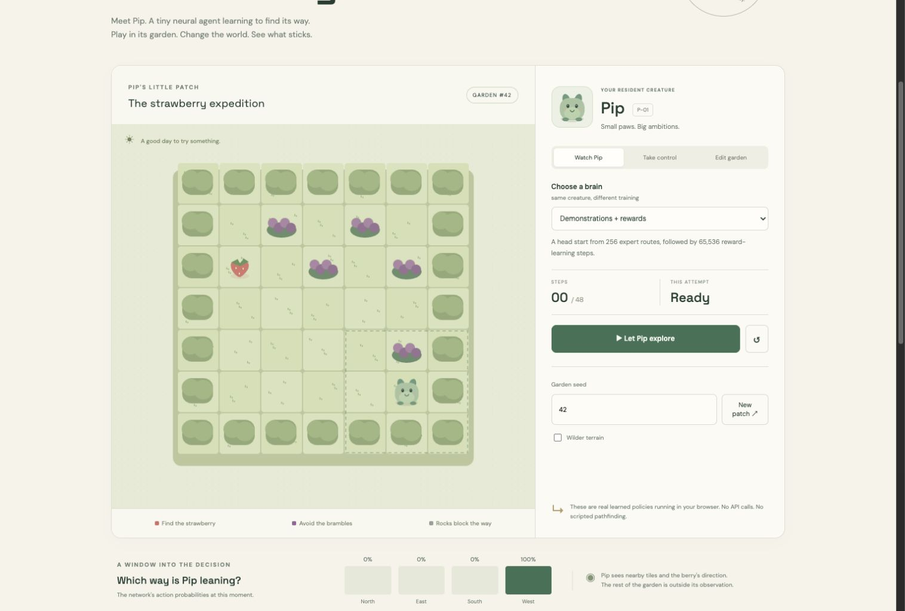
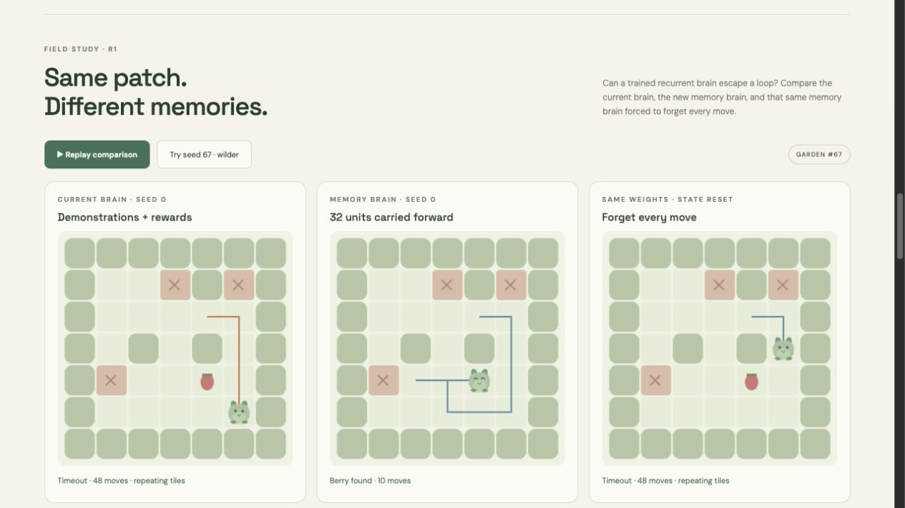
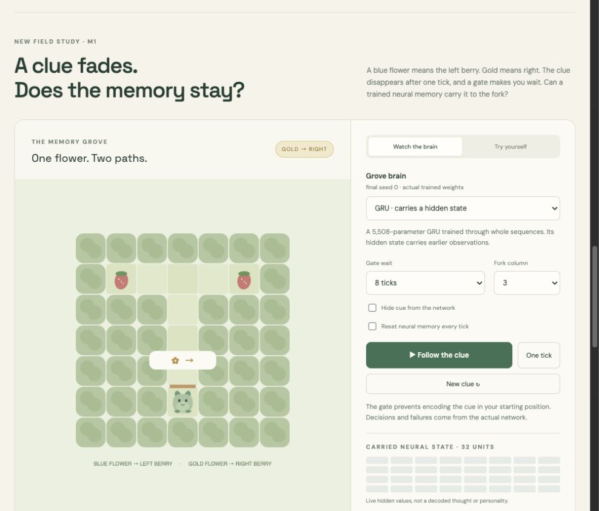
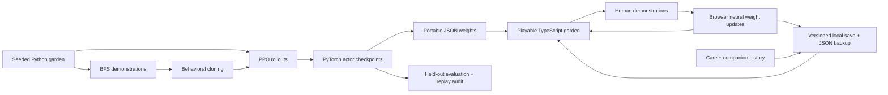

<div align="center">

# ✳ CritterLab

**A small creature. A real neural network. A little world for learning.**

[Research report](docs/research-results.md) · [Play](https://shunhe-wang.github.io/critterlab/) · [Garden memory results](docs/navigation-memory-results.md) · [Clue memory results](docs/memory-results.md) · [Model cards](docs/model-card.md)


</div>

## Research report: when does imitation help or hurt reinforcement learning?

**[Read the findings, uncertainty and limitations →](docs/research-results.md)**

The study uses **350 training runs and ten paired seeds** to compare BC, PPO,
BC→PPO, exploration controls, fixed/adaptive imitation and a DAgger-style
baseline across standard, dense and barrier maps. Exact-world-disjoint pools
are fixed before optimization, with matched interaction/update budgets and
targeted ablations of demonstration volume, label noise, reward shaping and
network width. Every final actor and evaluation action sequence is available.

The results show where imitation's advantage shrinks under shift, how greedy
evaluation can hide PPO's sampled performance, and why the adaptive alternative
does not establish an improvement over BC→PPO. The adaptive rule uses
established ideas; this study does not claim a novel learning algorithm.
This study is separate from the browser checkpoints.

[Fixed protocol](docs/research-protocol.md) ·
[Raw data and reproduction](research/README.md) ·
[Failure analysis](docs/research-failures.md) ·
[Primary-source background](docs/research-background.md)



Meet **Pip**, a 5,764-parameter neural agent trying to reach a strawberry without
walking into brambles. Play its garden, change the terrain, compare trained
brains, and teach it a route yourself. Every autonomous move comes from the
network's action probabilities.

**Now a companion you can return to:** name your pet, share snacks, cuddle,
take naps and build a little history together. The garden, current adventure,
lessons and adapted neural weights autosave in your browser. Friendship stages
unlock a scarf and a keepsake badge. Your pet never dies from time away.

**New: memory in the normal gardens.** A trained 5,316-parameter GRU remembers
its observation history. Watch the current brain, memory brain and memory-reset
control on the same patch in the [loop lab](https://shunhe-wang.github.io/critterlab/#navigation-lab),
or select it for your pet's own adventures. On seed 67 with wilder terrain, it
finds the berry in 10 moves while the current seed-0 brain loops until timeout.
Across unseen gardens it reduces loops but enters more brambles and succeeds
less often. The current brain remains the default.



**New: the memory grove.** A flower gives a clue, then disappears. Can Pip
remember which berry it meant? A trained 5,508-parameter GRU carries
32 hidden units between actions. Compare it with a reactive actor trained on
the same examples and the frozen original brain, or try the clue yourself.



## What you can do

- **Watch** six real garden checkpoints: untrained, demonstrations only, rewards only,
  demonstrations followed by reward learning, a recurrent brain and its retrained
  reactive control.
- **Play** with arrow keys, WASD, or touch controls.
- **Raise** a named companion with time-based needs, cosmetic growth and a
  persistent adventure diary. Care has cooldowns; friendship isn't a neural score.
- **Talk** using a small command vocabulary: “snack”, “cuddle”, “nap”, “wake”,
  “explore”, “how are you?”, “memories” and “lessons”. Replies use actual pet
  state. This is authored dialogue, not a language model.
- **Teach** a successful route: cross-entropy backpropagation updates a copy of
  the neural weights inside your browser. Your lessons and actual adapted
  weights persist across refreshes. Try another garden to
  find out whether the lesson transfers.
- **Keep** your pet with a portable JSON backup. Restore validates the garden,
  episode replay and model dimensions before replacing your companion.
- **Edit** rocks, brambles and the berry, using mouse or keyboard-accessible tile
  controls. A separate solver reports solvability; it never acts for Pip.
- **Inspect** action probabilities, scrub the episode journal, export a replay,
  and explore real learning curves and evaluation results.
- **Experiment with memory** in the [playable grove](https://shunhe-wang.github.io/critterlab/#memory-lab):
  vary the delay, erase the clue, reset recurrent state, inspect live activations,
  and download a trial. Finished trials join your pet's diary.
- **Compare navigation** in the [loop lab](https://shunhe-wang.github.io/critterlab/#navigation-lab):
  replay three brains on the same garden, reproduce seed 67, and inspect the
  recurrent state in the main garden. Saved adventures rebuild memory from their
  actual action history. Browser teaching currently supports reactive brains.

Browser inference and teaching require no account, API key, inference server,
or paid service. Optional Google Fonts have system-font fallbacks. There is no
analytics or automatic upload of your interactions.

Saves are local to a browser and site origin. There is no account or cloud sync;
clearing site data removes the pet, so download a backup. Another tab's saved
changes pause and refresh this tab. [Companion rules and save contract](docs/pet-contract.md)
describe away-time limits, care rewards and the dialogue boundary.

## Random-garden memory experiment, actually run

The original garden and 20 observation features stay unchanged. A GRU and a
new reactive actor receive the same 256 expert sequences, 180 BC updates and
65,536 PPO interactions per model seed. All three seeds and the final seed-0
demo export were fixed before training. Test worlds are exactly disjoint from
both v1 and r1 training worlds.

| Actor | Standard success | Standard loop timeout | Wilder success | Wilder loop timeout |
|---|---:|---:|---:|---:|
| Current BC → PPO | **87.0 ± 1.6%** | 13.0 ± 1.6% | 74.5 ± 1.2% | 25.5 ± 1.2% |
| Memory GRU | 77.9 ± 2.3% | **7.9 ± 0.5%** | 68.5 ± 1.6% | **16.4 ± 0.7%** |
| Retrained reactive | 88.7 ± 0.0% | 11.3 ± 0.0% | **77.0 ± 1.8%** | 23.0 ± 1.8% |
| GRU, reset every move | 26.7 ± 2.2% | 68.0 ± 2.1% | 19.8 ± 1.8% | 77.1 ± 2.9% |

Mean ± sample standard deviation across three model seeds; 256 unique gardens
per split. Loop timeout means the final six positions repeat one or two tiles
at the 48-action limit. The GRU reaches brambles in 12.1% of standard cases;
both reactive actors reach none. Fewer loops do not establish a better brain.
The frozen current actor has a different historical training regimen; the newly
trained reactive actor is the matched control. Equal updates and interactions
do not mean equal compute. Seed 67 is a known diagnostic, excluded from these
scores. Another known loop, seed 1100001, remains unsolved by every trained actor.

[Full report, paired loop recoveries and limitations](docs/navigation-memory-results.md) ·
[Predeclared protocol](docs/navigation-memory-protocol.md) ·
[All recorded episodes](results/navigation-r1.json)

## Clue-memory experiment, actually run

Two new architectures trained on the same 36 expert sequences (330 transitions)
for 200 Adam updates, with three paired seeds. The protocol and seed-0 demo
export were declared before training. Test geometry was absent from training.

| Actor | Unseen gardens, delays 2/4/8 | Unseen gardens, delays 16/32 |
|---|---:|---:|
| Recurrent GRU | **88.9 ± 19.2%** | **66.7 ± 28.9%** |
| Retrained reactive | 50.0 ± 0.0% | 50.0 ± 0.0% |
| Frozen original BC → PPO | 16.7 ± 0.0% | 16.7 ± 0.0% |

Mean ± sample standard deviation over three model seeds; 18 standard and 12
long-delay cases per seed. These are finite synthetic cases, not a broad
population estimate. The frozen actor is an out-of-task reference; the retrained
reactive actor is the controlled comparison. Equal updates do not mean equal
compute. Erasing the cue reduces GRU success to 50%; swapping it gives 0%.
Long waits expose substantial seed variation, which is preserved in the results.
[Report, per-seed scores and controls](docs/memory-results.md) ·
[Fixed protocol](docs/memory-protocol.md) · [Memory model card](docs/memory-model-card.md)

## Navigation experiment, actually run

We compare a common small tanh network under behavioral cloning (BC), PPO, and
BC → PPO. Demonstrations contain 1,290 state/action pairs from 256 BFS expert
episodes. Each PPO condition gets 65,536 environment steps per training seed.
The three paired training seeds are 0, 1 and 2. All training was run on CPU;
every actor checkpoint and evaluation episode is committed.

| Method | Standard seed-held-out success | Wilder seed-held-out success |
|---|---:|---:|
| Untrained, greedy | 0.0 ± 0.0% | 0.0 ± 0.0% |
| BC | 77.9 ± 2.8% | 62.8 ± 2.2% |
| PPO | 76.6 ± 2.0% | 64.3 ± 0.8% |
| BC → PPO | **86.6 ± 1.2%** | **76.4 ± 2.4%** |

Mean ± sample standard deviation across training seeds, 256 episodes per split
per seed. A separate random-action baseline reaches 28.9% on standard terrain;
untrained greedy behavior should not be confused with random actions.

**An audit found that different RNG seeds sometimes generate identical worlds.**
The seed-held-out results above therefore include small exact-world overlaps.
A post-hoc common subset excluding every world seen by any training condition
leaves 243 standard and 255 wilder test gardens. On that subset, BC → PPO achieves
**85.9 ± 1.3%**, versus **75.3 ± 2.1%** for PPO on standard terrain. Both original
results and the sensitivity audit are published; no scores were silently
replaced. [Read the details and limitations](docs/results.md).

The BC condition uses additional expert information and optimization. This is
a comparison at a fixed **subsequent PPO interaction budget**, not a comparison
at equal total compute, data, or supervision. These are modest navigation
experiments, not a novel learning algorithm or a general-intelligence claim.

## Run the demo

Requires Node.js 22.12+ and npm.

```sh
npm ci
npm run dev
```

Open the localhost URL printed by Vite. The committed JSON policies work without
installing Python or rerunning training. `npm run build` makes a static `dist/`
site; `npm run preview` serves the production build.

## Reproduce the learning

Requires [uv](https://docs.astral.sh/uv/) and Python 3.12. The lockfile selects
CPU-only PyTorch on Linux. No GPU or paid model API is required.

```sh
uv sync --locked
uv run python -m critterlab.train --publish
uv run python -m scripts.overlap_audit
uv run python -m critterlab.audit
```

To reproduce the separate memory experiment:

```sh
uv run python -m critterlab.memory_train --publish
uv run python -m critterlab.memory_audit
```

To reproduce recurrent navigation in the normal gardens:

```sh
uv run python -m critterlab.navigation_train --publish
uv run python -m critterlab.navigation_audit
```

Navigation `--publish` enforces protocol-v1 budgets and seeds and exports **seed 0 final**
actors, not whichever seed looks best. Platform-dependent numeric differences
are possible; the original environment, package versions, source hashes, and
per-seed results are recorded. For a short training smoke run that doesn't
replace release artifacts:

```sh
uv run python -m critterlab.train --steps 2048 --seeds 0 --output /tmp/critterlab-smoke.json
```

The follow-up study has a separate runner and replay audit:

```sh
uv run python -m critterlab.research --output research/reproduced.json.gz
uv run python -m critterlab.research_audit research/reproduced.json.gz
uv run python -m critterlab.research_report research/reproduced.json.gz --output /tmp/critterlab-report
```

[Artifact format and reproduction details](research/README.md).

## Verify

```sh
uv run pytest -q
uv run python -m critterlab.audit
uv run python -m critterlab.memory_audit
uv run python -m critterlab.navigation_audit
npm run check
```

Checks cover hand-worked world rules, actual weight updates, Python/TypeScript
world parity, PyTorch/browser policy probabilities, and replaying **7,168**
published navigation episodes and **432** memory episodes to recompute metrics
and neural actions. The new navigation audit independently replays **6,192**
episodes, rebuilding whole observation prefixes to check carried-state inference.
Memory checks cover cue isolation, geometry separation, terminal state resets,
PPO sequence boundaries and PyTorch/browser GRU parity. The optional
[manual verification workflow](.github/workflows/ci.yml) also replays the
research results, regenerates their analysis and the world-overlap audit, and
checks that the committed results are unchanged.

GitHub Actions does **not** run automatically on pushes, PR updates or merges.
Verification and Pages deployment are manual-only: open the relevant workflow
in the repository's **Actions** tab and choose **Run workflow** when needed.

## Architecture



| Path | Purpose |
|---|---|
| `critterlab/world.py` | Normative environment, observation and expert solver |
| `critterlab/train.py` | Behavioral cloning, clipped PPO, GAE and evaluation |
| `critterlab/audit.py` | Reproduce outcomes from recorded actions |
| `web/engine.ts` | Matching world and dense/tanh inference in the browser |
| `web/learn.ts` | Real browser-side supervised weight updates |
| `critterlab/memory_*.py` | Cue environment, sequence training and independent audit |
| `web/memory.ts`, `web/memory-ui.ts` | Matching recurrent inference and playable memory grove |
| `critterlab/navigation_*.py` | Disjoint garden splits, sequence BC, recurrent PPO and independent audit |
| `web/navigation.ts`, `web/navigation-ui.ts` | Garden GRU inference, replay reconstruction and three-way comparison |
| `web/pet.ts` | Companion rules, grounded command vocabulary and save validation |
| `checkpoints/` | All 12 original navigation, six cue-memory and six new navigation PyTorch state dictionaries |
| `public/models/` | Six garden and two cue-memory seed-0 policies |
| `results/` | Raw evaluation episodes, training map seeds and overlap audits |
| `failure-cases/` | Reproducible failures of learned policies |

## What v0.4 does and does not establish

The original garden actor is reactive, observing nearby tiles and the known
goal direction. The new garden GRU and separate memory-grove GRU carry recurrent
state within episodes. None is a language model or global-map planner. The app's
persisted companion diary and adapted garden weights are separate from the
GRU's short-term hidden state. A small model
can learn useful behavior and still loop at a rock or oscillate between tiles.
The demonstration solver has access to information the actor does not have;
some expert decisions are therefore impossible to reconstruct from one local
observation. The environment supplies dense Manhattan-distance shaping.

The clue experiment demonstrates learned memory in a constrained task. The
random-garden experiment resolves some cycles, including the reported seed 67,
while exposing a hazard/success tradeoff. Neither establishes conversational
understanding or superior general navigation. Useful next experiments include
hazard-sensitive training, sparse rewards and controlled human-demonstration studies.
Browser teaching is an exploratory interaction, independent of the
reported offline experiment.

## Attribution

MIT licensed. Original procedural creature/terrain artwork and project code.
Established algorithms are credited in
[references](docs/references.md); PyTorch, NumPy and Vite are dependencies. No
external game assets, MiniGrid implementation, or third-party repository code
is bundled.
