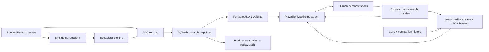

<div align="center">

# ✳ CritterLab

**A small creature. A real neural network. A little world for learning.**

[Play the garden](https://shunhe-wang.github.io/critterlab/) · [Research study](docs/research-results.md) · [Original experiment](docs/results.md) · [Model card](docs/model-card.md)

[](https://github.com/shunhe-wang/critterlab/actions/workflows/ci.yml)


</div>


Meet **Pip**, a 5,764-parameter neural agent trying to reach a strawberry without
walking into brambles. Play its garden, change the terrain, compare trained
brains, and teach it a route yourself. Every autonomous move comes from the
network's action probabilities.

**Now a companion you can return to:** name your pet, share snacks, cuddle,
take naps and build a little history together. The garden, current adventure,
lessons and adapted neural weights autosave in your browser. Friendship stages
unlock a scarf and a keepsake badge. Your pet never dies from time away.

## What you can do

- **Watch** four real checkpoints: untrained, demonstrations only, rewards only,
  and demonstrations followed by reward learning.
- **Play** with arrow keys, WASD, or touch controls.
- **Raise** a named companion with time-based needs, cosmetic growth and a
  persistent adventure diary. Care has cooldowns; friendship isn't a neural score.
- **Talk** using a small command vocabulary: “snack”, “cuddle”, “nap”, “wake”,
  “explore”, “how are you?”, “memories” and “lessons”. Replies use actual pet
  state. This is authored dialogue, not a language model.
- **Teach** a successful route: cross-entropy backpropagation updates a copy of
  the neural weights inside your browser. Your lessons and actual adapted
  weights persist across refreshes. Try another garden to
  find out whether the lesson transfers.
- **Keep** your pet with a portable JSON backup. Restore validates the garden,
  episode replay and model dimensions before replacing your companion.
- **Edit** rocks, brambles and the berry, using mouse or keyboard-accessible tile
  controls. A separate solver reports solvability; it never acts for Pip.
- **Inspect** action probabilities, scrub the episode journal, export a replay,
  and explore real learning curves and evaluation results.

Browser inference and teaching require no account, API key, inference server,
or paid service. Optional Google Fonts have system-font fallbacks. There is no
analytics or automatic upload of your interactions.

Saves are local to a browser and site origin. There is no account or cloud sync;
clearing site data removes the pet, so download a backup. Another tab's saved
changes pause and refresh this tab. [Companion rules and save contract](docs/pet-contract.md)
describe away-time limits, care rewards and the dialogue boundary.

## Research investigation: imitation under distribution shift

**When does source imitation help or hurt reinforcement-learning adaptation?**
The follow-up study compares BC, PPO, BC→PPO, entropy controls, fixed/adaptive
imitation, and a DAgger-style baseline across standard, dense and barrier maps.
It fixes exact-world-disjoint pools before optimization and uses ten paired
training seeds, matched interaction/update budgets, and paired uncertainty.
Targeted ablations vary demonstration volume, label noise, reward shaping and
network width. Every final actor and evaluation action sequence is available.

[Read the findings and limitations](docs/research-results.md),
[the protocol](docs/research-protocol.md), and
[the primary-source background](docs/research-background.md).
The adaptive rule is a tested heuristic using established ideas; a score alone
does not establish algorithmic novelty. This study was developed with AI
assistance and is separate from the original browser checkpoints.

## The original experiment, actually run

We compare a common small tanh network under behavioral cloning (BC), PPO, and
BC → PPO. Demonstrations contain 1,290 state/action pairs from 256 BFS expert
episodes. Each PPO condition gets 65,536 environment steps per training seed.
The three paired training seeds are 0, 1 and 2. All training was run on CPU;
every actor checkpoint and evaluation episode is committed.

| Method | Standard seed-held-out success | Wilder seed-held-out success |
|---|---:|---:|
| Untrained, greedy | 0.0 ± 0.0% | 0.0 ± 0.0% |
| BC | 77.9 ± 2.8% | 62.8 ± 2.2% |
| PPO | 76.6 ± 2.0% | 64.3 ± 0.8% |
| BC → PPO | **86.6 ± 1.2%** | **76.4 ± 2.4%** |

Mean ± sample standard deviation across training seeds, 256 episodes per split
per seed. A separate random-action baseline reaches 28.9% on standard terrain;
untrained greedy behavior should not be confused with random actions.

**An audit found that different RNG seeds sometimes generate identical worlds.**
The seed-held-out results above therefore include small exact-world overlaps.
A post-hoc common subset excluding every world seen by any training condition
leaves 243 standard and 255 wilder test gardens. On that subset, BC → PPO achieves
**85.9 ± 1.3%**, versus **75.3 ± 2.1%** for PPO on standard terrain. Both original
results and the sensitivity audit are published; no scores were silently
replaced. [Read the details and limitations](docs/results.md).

The BC condition uses additional expert information and optimization. This is
a comparison at a fixed **subsequent PPO interaction budget**, not a comparison
at equal total compute, data, or supervision. These are modest navigation
experiments, not a novel learning algorithm or a general-intelligence claim.

## Run the demo

Requires Node.js 22.12+ and npm.

```sh
npm ci
npm run dev
```

Open the localhost URL printed by Vite. The committed JSON policies work without
installing Python or rerunning training. `npm run build` makes a static `dist/`
site; `npm run preview` serves the production build.

## Reproduce the learning

Requires [uv](https://docs.astral.sh/uv/) and Python 3.12. The lockfile selects
CPU-only PyTorch on Linux. No GPU or paid model API is required.

```sh
uv sync --locked
uv run python -m critterlab.train --publish
uv run python -m scripts.overlap_audit
uv run python -m critterlab.audit
```

`--publish` enforces protocol-v1 budgets and seeds and exports **seed 0 final**
actors, not whichever seed looks best. Platform-dependent numeric differences
are possible; the original environment, package versions, source hashes, and
per-seed results are recorded. For a short training smoke run that doesn't
replace release artifacts:

```sh
uv run python -m critterlab.train --steps 2048 --seeds 0 --output /tmp/critterlab-smoke.json
```

The follow-up study has a separate runner and replay audit:

```sh
uv run python -m critterlab.research --output research/reproduced.json.gz
uv run python -m critterlab.research_audit research/reproduced.json.gz
uv run python -m critterlab.research_report research/reproduced.json.gz --output /tmp/critterlab-report
```

[Artifact format and reproduction details](research/README.md).

## Verify

```sh
uv run pytest -q
uv run python -m critterlab.audit
npm run check
```

Checks cover hand-worked world rules, actual weight updates, Python/TypeScript
world parity, PyTorch/browser policy probabilities, and replaying **7,168**
published evaluation episodes to recompute metrics. CI also regenerates the
world-overlap audit and checks that the committed results are unchanged.

## Architecture



| Path | Purpose |
|---|---|
| `critterlab/world.py` | Normative environment, observation and expert solver |
| `critterlab/train.py` | Behavioral cloning, clipped PPO, GAE and evaluation |
| `critterlab/audit.py` | Reproduce outcomes from recorded actions |
| `web/engine.ts` | Matching world and dense/tanh inference in the browser |
| `web/learn.ts` | Real browser-side supervised weight updates |
| `web/pet.ts` | Companion rules, grounded command vocabulary and save validation |
| `checkpoints/` | All 12 final PyTorch actor state dictionaries |
| `public/models/` | Four portable seed-0 policies |
| `results/` | Raw evaluation episodes, training map seeds and overlap audits |
| `failure-cases/` | Three reproducible failures of learned policies |

## What v0.2 does and does not establish

Pip is a reactive agent observing nearby tiles and the known goal direction. It
has no language model, recurrent neural memory, or global-map planner. The app
persists a companion diary and adapted weights; neither makes the actor recurrent.
A small model
can learn useful behavior and still loop at a rock or oscillate between tiles.
The demonstration solver has access to information the actor does not have;
some expert decisions are therefore impossible to reconstruct from one local
observation. The environment supplies dense Manhattan-distance shaping.

Useful next experiments include a recurrent policy for ambiguous observations,
a sparse-reward condition, controlled human-demonstration studies, and a
world-disjoint split fixed before training. These are future work, not shipped
results. Browser teaching is an exploratory interaction, independent of the
reported offline experiment.

## Attribution

MIT licensed. Original procedural creature/terrain artwork and project code,
developed with AI assistance. Established algorithms are credited in
[references](docs/references.md); PyTorch, NumPy and Vite are dependencies. No
external game assets, MiniGrid implementation, or third-party repository code
is bundled.
