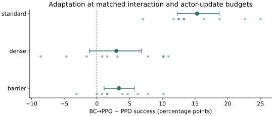
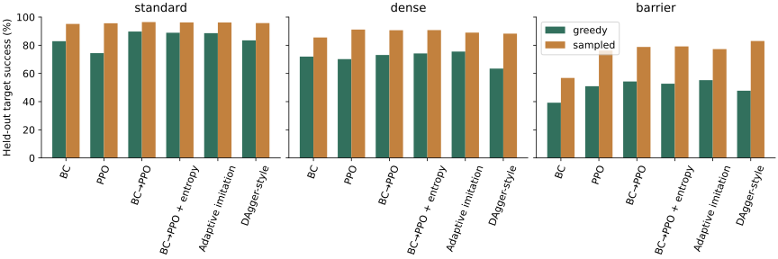
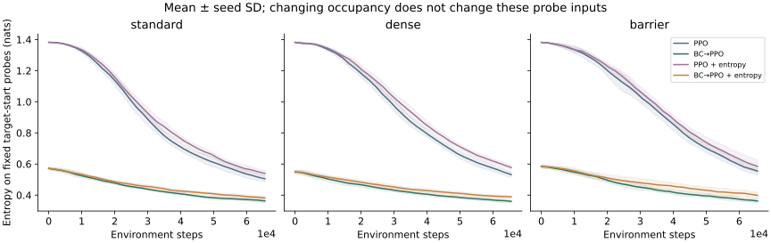

# Imitation under distribution shift: a controlled CritterLab study

Executed CPU experiment, 2026-10-11. Developed with AI assistance. This is
an empirical research artifact in a small navigation environment; it is not
a claim of a new algorithm or independently validated discovery.

**350 training runs, ten paired seeds, three terrain families.**
The primary comparison matches 65,536 environment interactions and 1,024
actor-update slots. BC→PPO allocates 128 slots to imitation and 896 to PPO;
PPO allocates all 1,024 to PPO. Extra expert information is reported, not erased.

[Protocol](research-protocol.md) · [Primary-source background](research-background.md) ·
[Raw maps, all actors and episodes](../research/results.json.gz) ·
[Machine-readable analysis](../research/analysis.json) · [Failure traces](research-failures.md)

The greedy BC→PPO advantage is 15.31 percentage points on standard, 2.97 percentage points on dense, 3.36 percentage points on barrier.
The dense interval includes zero.
The measured benefit is smaller on both shifted panels than on the standard panel.
This run does not show a reliable reversal into negative transfer.

The same-subsequent-PPO-update controls still favor BC initialization.
That makes the optimizer allocation cost part of the explanation: initialization
benefit and benefit at a fixed total update budget are different estimands.

Stronger entropy does not establish a BC-specific gain: all three entropy
difference-in-differences intervals include zero.
The adaptive rule also fails to convincingly outperform plain BC→PPO in these
panels. These negative or inconclusive tests are retained rather than replaced
by a winning variant.

On dense terrain, PPO succeeds on 70.16% of worlds greedily and 91.17% when sampled. BC→PPO's sampled score is 90.70%.
The sampled/greedy gap and recorded cycles point to an action-selection limitation
of the reactive controller, without identifying a BC-specific training mechanism.

The ablations add a condition: no-shaping raises the barrier pretraining advantage to 13.12 points; narrow-network raises the barrier pretraining advantage to 18.59 points.
Reward and network choices change the value of initialization at this budget.
The absolute scores below show whether the larger effect comes from BC→PPO improving
or PPO deteriorating; these are exploratory, one-factor comparisons.

The full protocol was committed before training in [1cc671b](https://github.com/shunhe-wang/critterlab/commit/1cc671ba255439f6c76166d89fa6064d7d723b6c).
The interpretation here was written after inspecting the executed results.

## Primary finding

Effects are **BC→PPO minus PPO**, in percentage points, on held-out worlds
of the family used for PPO training. Brackets are 95% paired-seed percentile
bootstrap intervals, conditional on the fixed map and demonstration panels.

| Adaptation terrain | Mean effect [95% interval] | Paired seed effects |
|---|---:|---|
| standard | +15.31 [+12.27, +18.67] | +22.7, +25.0, +12.5, +13.3, +11.7, +18.8, +13.3, +7.0, +12.5, +16.4 |
| dense | +2.97 [-1.17, +6.80] | +10.2, +10.2, -8.6, +0.8, +1.6, +10.9, -1.6, +3.1, -4.7, +7.8 |
| barrier | +3.36 [+1.09, +5.70] | +0.8, +10.2, +1.6, +1.6, +6.2, -3.1, +3.9, +7.8, +4.7, +0.0 |



Change in the greedy pretraining effect relative to standard terrain
(exploratory paired difference-of-differences):

| Shifted family | Shifted effect − standard effect [95% interval] |
|---|---:|
| dense | -12.34 [-15.31, -9.45] |
| barrier | -11.95 [-16.02, -7.81] |

These comparisons concern different frozen task panels; they do not isolate
obstacle density or topology from the other distribution changes.

The declared sampled-policy evaluation gives a separate sensitivity contrast:

| Adaptation terrain | Sampled BC→PPO − PPO [95% paired interval] |
|---|---:|
| standard | +0.86 [+0.31, +1.48] |
| dense | -0.47 [-1.72, +0.55] |
| barrier | +2.58 [+0.94, +4.06] |

These sampled estimates condition on one independent evaluation-RNG panel.
Different greedy and sampled conclusions concern deployment/action selection
as well as learning. A deterministic reactive controller that revisits a position
in a fixed map repeats its decision and can remain in a cycle; stochastic action
selection can escape it. The recorded traces expose this behavior directly.

## All methods

Mean goal success across ten trained seeds. Each seed gets the same 128 frozen
worlds per evaluation family. Greedy inference matches the browser policy;
sampled inference tests the training policy's action distribution.

| Method | Standard greedy / sampled | Dense greedy / sampled | Barrier greedy / sampled |
|---|---:|---:|---:|
| BC | 82.89% / 95.16% | 71.95% / 85.55% | 39.22% / 56.80% |
| PPO | 74.45% / 95.62% | 70.16% / 91.17% | 50.94% / 76.25% |
| PPO-short | 70.23% / 94.30% | 66.64% / 89.38% | 49.69% / 73.52% |
| BC→PPO | 89.77% / 96.48% | 73.12% / 90.70% | 54.30% / 78.83% |
| PPO + entropy | 74.06% / 95.31% | 70.08% / 90.94% | 50.31% / 75.31% |
| BC→PPO + entropy | 88.91% / 96.25% | 74.22% / 90.78% | 52.73% / 79.22% |
| Fixed imitation | 87.58% / 95.39% | 74.38% / 87.89% | 52.66% / 74.69% |
| Adaptive imitation | 88.59% / 96.17% | 75.55% / 88.98% | 55.23% / 77.27% |
| DAgger-style | 83.52% / 95.78% | 63.44% / 88.28% | 47.73% / 83.05% |

BC repeats the same source-only model across training-family blocks; these are
different test panels, not extra independent BC training seeds. DAgger queries
additional target-state expert labels and has a different supervision budget.



Exploratory sampled-minus-greedy effects on each same trained actor, in
percentage points with paired-seed intervals (no multiplicity correction):

| Method | Standard | Dense | Barrier |
|---|---:|---:|---:|
| PPO | +21.17 [+17.89, +24.61] | +21.02 [+17.66, +24.45] | +25.31 [+23.59, +27.19] |
| BC→PPO | +6.72 [+5.47, +7.81] | +17.58 [+15.78, +19.77] | +24.53 [+22.11, +27.19] |

## Mechanism tests and adaptive method

All following intervals are exploratory and uncorrected for multiple comparisons.

| Contrast (percentage points) | Standard | Dense | Barrier |
|---|---:|---:|---:|
| BC→PPO − PPO-short | +19.53 [+15.70, +23.28] | +6.48 [+3.28, +9.45] | +4.61 [+1.95, +7.27] |
| BC entropy gain − PPO entropy gain | -0.47 [-4.45, +3.91] | +1.17 [-3.59, +5.94] | -0.94 [-5.86, +3.75] |
| Adaptive − fixed imitation | +1.02 [+0.00, +2.11] | +1.17 [-0.23, +2.50] | +2.58 [-1.41, +5.86] |
| Adaptive − BC→PPO | -1.17 [-2.89, +0.55] | +2.42 [-0.08, +5.08] | +0.94 [-2.11, +3.91] |

The entropy contrast subtracts the benefit of stronger entropy in PPO itself.
A BC-specific gain, lower initial entropy, and improved visitation would be
consistent with an exploration account. They would not rule out objective,
occupancy, aliasing, or optimization explanations.



| Terrain / method | Initial target-probe entropy | Final target-probe entropy | Unique visited world/positions | Collision fraction |
|---|---:|---:|---:|---:|
| standard / PPO | 1.382 | 0.505 | 4331.3 | 0.120 |
| standard / BC→PPO | 0.571 | 0.362 | 3209.9 | 0.026 |
| standard / PPO + entropy | 1.382 | 0.540 | 4342.9 | 0.121 |
| standard / BC→PPO + entropy | 0.571 | 0.382 | 3270.4 | 0.026 |
| standard / Adaptive imitation | 0.571 | 0.367 | 3189.9 | 0.028 |
| dense / PPO | 1.382 | 0.532 | 3688.3 | 0.161 |
| dense / BC→PPO | 0.549 | 0.360 | 2798.0 | 0.058 |
| dense / PPO + entropy | 1.382 | 0.577 | 3712.5 | 0.167 |
| dense / BC→PPO + entropy | 0.549 | 0.389 | 2837.0 | 0.058 |
| dense / Adaptive imitation | 0.549 | 0.355 | 2768.4 | 0.060 |
| barrier / PPO | 1.382 | 0.555 | 3462.0 | 0.181 |
| barrier / BC→PPO | 0.584 | 0.362 | 2743.6 | 0.075 |
| barrier / PPO + entropy | 1.382 | 0.585 | 3499.6 | 0.184 |
| barrier / BC→PPO + entropy | 0.584 | 0.398 | 2782.2 | 0.079 |
| barrier / Adaptive imitation | 0.584 | 0.369 | 2666.4 | 0.073 |

Visitation counts depend on episode termination and the finite pool; more
visited states are not automatically useful exploration. Entropy is in nats.

## One-factor ablations

Barrier adaptation, ten seeds per condition. Change from main subtracts the
primary barrier effect using the same seed blocks. This is not a full factorial.

| Change | PPO greedy | BC→PPO greedy | BC→PPO − PPO [95% interval] | Effect change from main [95% interval] |
|---|---:|---:|---:|---:|
| few-demos | 50.94% | 53.44% | +2.50 [-1.95, +6.72] | -0.86 [-4.30, +2.58] |
| noisy-labels | 50.94% | 53.28% | +2.34 [-0.08, +5.31] | -1.02 [-3.59, +1.17] |
| no-shaping | 42.89% | 56.02% | +13.12 [+8.83, +17.34] | +9.77 [+4.61, +14.84] |
| narrow-network | 32.89% | 51.48% | +18.59 [+14.37, +23.12] | +15.23 [+9.77, +20.55] |

## Zero-shot transfer is a separate question

These models are trained **only on standard terrain** and evaluated without
any dense/barrier adaptation. Do not interpret this table as target learning.

| Standard-trained method | Standard | Dense | Barrier |
|---|---:|---:|---:|
| PPO | 74.45% | 68.05% | 42.89% |
| BC→PPO | 89.77% | 77.03% | 50.86% |
| Adaptive imitation | 88.59% | 78.44% | 50.70% |

## What changed between terrain families?

Descriptors below are for the frozen test panels. Barriers alter topology
and hidden information, not only an abstract complexity level.

| Test family | Worlds | Shortest path | Manhattan distance | Detour excess | Interior rock fraction | Interior hazard fraction |
|---|---:|---:|---:|---:|---:|---:|
| standard | 128 | 5.03 | 4.59 | 0.44 | 0.069 | 0.062 |
| dense | 128 | 5.29 | 4.70 | 0.59 | 0.135 | 0.095 |
| barrier | 128 | 6.41 | 4.68 | 1.73 | 0.210 | 0.035 |

## Resource accounting

Means across main-study family/seed blocks. Updates and label presentations
are counts, not equal FLOPs. All source demonstrations are reused across seeds.

The shared main source dataset has 256 worlds and 1304 labeled transitions.
Raw `source_expert_queries` records that prepared dataset's size for every
run, including PPO's read-only expert-state diagnostics. PPO's zero source
label presentations mean no expert label enters its optimization. Do not sum
the shared source count across model seeds. DAgger's new queries are separate.

| Method | Env steps | Actor / critic updates | Source label presentations | New target expert queries | Training seconds |
|---|---:|---:|---:|---:|---:|
| BC | 0 | 1024 / 0 | 262144 | 0 | 0.63 |
| PPO | 65536 | 1024 / 1024 | 0 | 0 | 4.25 |
| PPO-short | 65536 | 896 / 896 | 0 | 0 | 3.78 |
| BC→PPO | 65536 | 1024 / 896 | 32768 | 0 | 4.39 |
| PPO + entropy | 65536 | 1024 / 1024 | 0 | 0 | 4.21 |
| BC→PPO + entropy | 65536 | 1024 / 896 | 32768 | 0 | 3.67 |
| Fixed imitation | 65536 | 1024 / 896 | 262144 | 0 | 3.99 |
| Adaptive imitation | 65536 | 1024 / 896 | 262144 | 0 | 4.09 |
| DAgger-style | 65536 | 1024 / 0 | 189697 | 1304 | 3.19 |

Total elapsed wall time: 1631.3 seconds (including evaluation and serialization).
Runtime: `macOS-15.7.7-arm64-arm-64bit`, PyTorch `2.14.1`, NumPy `2.5.4`, CPU.

## Reproduce and audit

```sh
uv sync --locked
uv run python -m critterlab.research --output research/reproduced.json.gz
uv run python -m critterlab.research_audit research/reproduced.json.gz
uv run python -m critterlab.research_report research/reproduced.json.gz --output /tmp/critterlab-report
```

For a short harness run, use `--smoke --output /tmp/critterlab-research-smoke.json.gz`.
Smoke results are explicitly marked non-protocol. The full artifact contains
all final actor weights and 268,800 evaluation action sequences, and the audit
recomputes outcomes, greedy/sampled inference, metrics, split identities, and budgets.

Outcomes are replayed exactly. Actor checks allow 1e-6 probability differences
at greedy ties or sampled CDF boundaries across CPUs, without replacing recorded actions.

Raw artifact SHA-256: `1a8af9bd95d4e7ccbe1d637d21db31550e5741efcb45dc964861ddda683df957`.

## Limits and next falsifying experiments

This run conditions on one source dataset and one finite pool per family.
Seed bootstrap intervals measure training variation, not map-population or
demonstration-sampling uncertainty. Secondary results are exploratory; no
multiple-comparison correction or independent replication is claimed.

The actor has no memory and sees less than the expert. We have not controlled
aliasing with a full-observation or recurrent model. Reward shaping is not
guaranteed policy-invariant, and label corruption is not a coherent poor expert.
An adaptive heuristic has prior conceptual neighbors; a better score would
not establish novelty. Its gate also lowers the average imitation penalty
relative to the fixed .1 baseline: any advantage could be penalty strength
rather than adaptation. A matched-average constant/time schedule is still needed.
No holdout was used for checkpoint selection or tuning.

Useful next tests: independently resample demonstrations and map pools;
control observation aliasing with memory/full-state policies; compare the gate
with a matched time schedule and target demonstrations; independently reproduce
the most informative boundary on a larger environment. A null or failed adaptive
method remains evidence if its limitations are reported.
